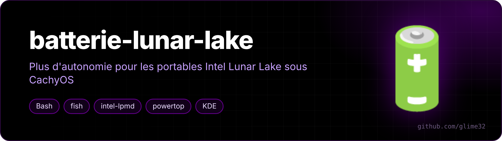
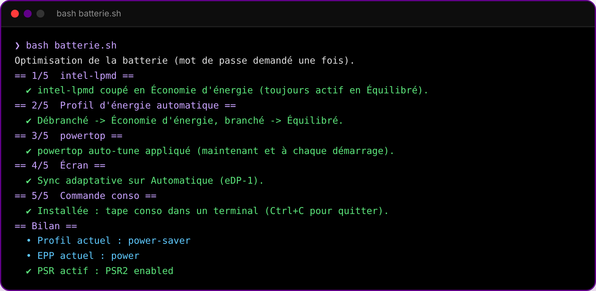
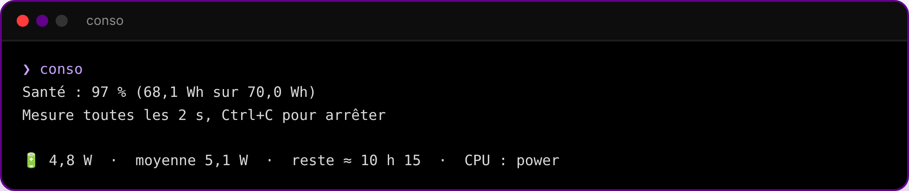

<p align="center"></p>

<p align="center">   </p>

<p align="center"><a href="README.fr.md">🇫🇷 Version française</a></p>

**Battery tweaks for Intel Lunar Lake laptops (Core Ultra 200V) on CachyOS + KDE Plasma**, a live `conso` power meter, and a one-click "conservation mode" button for Lenovo laptops.

My Yoga 7 2-in-1 (Core Ultra 7 258V) lasted noticeably less than on Windows. Here's what I found and fixed.

## The problem

On new installs, CachyOS's hardware detection (`chwd`) installs **intel-lpmd**. Its Lunar Lake config (`intel_lpmd_config_F6_M189.xml`) keeps it active even in the *Power Saver* profile, where it forces the CPU EPP between 64 and 192 depending on load — instead of 255 (`power`, the most efficient). So in "power saver", the CPU behaves almost like balanced mode.

`batterie.sh` sets `PowersaverDef` to `-1`: intel-lpmd stays out of Power Saver but keeps working in Balanced. The original config is backed up next to it.

<p align="center"></p>

## What `batterie.sh` does

1. fixes intel-lpmd (if installed);
2. automatic profiles in PowerDevil: plugged in → Balanced, on battery → Power Saver;
3. `powertop --auto-tune` at every boot, except USB mice/keyboards (they would lag);
4. adaptive sync set to *Automatic* (on *Always* it prevents PSR);
5. installs the `conso` fish function;
6. prints a summary: profile, EPP, intel-lpmd, PSR, Wi-Fi power save.

Safe to run again; it skips what's already done.

```bash
git clone https://github.com/glime32/batterie-lunar-lake
cd batterie-lunar-lake
bash batterie.sh     # no sudo, it asks when needed
```

## `conso` — live battery draw

<p align="center"><br><sub>example output</sub></p>

Works with batteries exposing `power_now`/`energy_now` as well as `current_now`/`voltage_now`.

## Conservation mode button (Lenovo)

`mode-conservation.fish` adds a taskbar button that toggles Lenovo's battery conservation mode (charging stops around 60 % to preserve the battery when the laptop stays plugged in).

```bash
fish mode-conservation.fish   # no sudo
```

It installs a tiny root helper that only accepts `on/off/toggle/status`, a sudoers rule limited to that helper (checked with `visudo` first), a boot service, and a pinned launcher with a notification on each change. It uses the current `charge_types` kernel interface (`Long_Life`/`Standard`) and falls back to the older `conservation_mode`.
